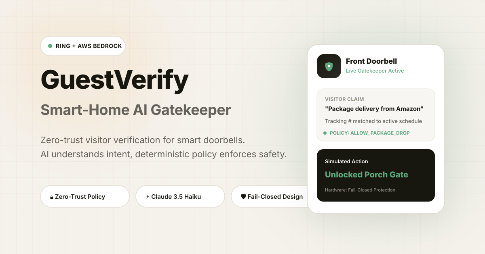

# GuestVerify — Smart-Home AI Gatekeeper

<p align="center">
  
</p>

<p align="center">
  <strong>Zero-Trust AI Gatekeeper for Ring Smart Home Doorbells</strong><br />
  <em>AI understands natural language visitor intent — Deterministic policy enforces physical security.</em>
</p>

<p align="center">
  <a href="https://github.com/Satyam2307/GuestVerify/actions"></a>
  
  
  
  
  
</p>

---

## Overview

Smart doorbells tell you *someone is at the door*. **GuestVerify** understands *who they are, what they want, cross-references your active schedules, and applies deterministic security policies* before any physical lock action is authorized.

An AI model **never blindly unlocks your door**. Amazon Bedrock is used strictly as an **intent extraction parser**; final door actions (`ALLOW_PACKAGE_DROP`, `SIMULATED_UNLOCK_MAIN_DOOR`, `OWNER_REVIEW_REQUIRED`, `CREATE_SECURITY_ALERT`) are governed by a fail-closed deterministic policy engine.

---

## Key Highlights

- **🔒 Zero-Trust Separation** — AI interprets speech transcripts; pure deterministic code grants or denies physical access.
- **⚡ Amazon Bedrock (Claude 3.5 Haiku)** — Extracts structured visitor claims (claimed identity, recipient, purpose, tracking numbers, and risk flags).
- **🛡️ Fail-Closed Security Model** — Unannounced strangers, expired visitor passes, or prompt injection attempts immediately fail closed to `DENIED_UNKNOWN` or trigger emergency homeowner alerts.
- **⏱️ Time-Bound Access Windows** — Supports active package tracking numbers, recurring caretaker windows, and one-off guest schedules.
- **📡 Real-Time SSE Event Stream** — Server-Sent Events push live door triggers, telemetry, and decision traces to the frontend in milliseconds.
- **🎨 Dark-Framed Editorial UI** — Dark obsidian navbar and footer framing a warm canvas with modern typography and interactive decision pipeline trace animations.
- **🛡️ Enterprise Security Hardened** — Includes HSTS padlock headers, strict CORS, in-memory sliding window rate limiting, input sanitization against XSS, and blocked sensitive file access.

---

## Architecture Flow

```
[ Ring Doorbell / Simulator ]
            │  (motion, chime, transcript)
            ▼
[ FastAPI Secure Ingestion ] ──► (X-Ring-Token & Rate Limiting)
            │
            ▼
[ Amazon Bedrock Analysis ] ──► (Extracts claimed carrier, recipient, purpose, risk flags)
            │
            ▼
[ Manifest & Schedule Match ] ──► (Cross-checks active deliveries.json & guest list)
            │
            ▼
[ Deterministic Policy Engine ] ──► (Zero-trust rules: APPROVED, REVIEW, or DENIED)
            │
            ▼
[ Action Simulator & Audit Log ] ──► (Simulates porch box unlock / alert + logs SSE stream)
```

---

## Project Structure

```
GuestVerify/
├── .github/workflows/
│   └── ci.yml                 # Automated testing & frontend build CI pipeline
├── backend/
│   ├── app/
│   │   ├── config.py          # Environment, CORS, and Bedrock settings
│   │   ├── main.py            # FastAPI entry point, static asset & SPA serving
│   │   ├── middleware.py      # Security headers & in-memory sliding rate limiter
│   │   ├── models.py          # Pydantic domain models
│   │   ├── routers/           # Webhook, schedules, events, contact, health routers
│   │   ├── services/          # Bedrock AI extractor & Deterministic policy engine
│   │   └── storage/           # JSON manifest & memory event audit stores
│   └── tests/                 # Comprehensive verification & policy engine tests
├── frontend/
│   ├── public/                # Favicon, sitemap.xml, robots.txt, llms.txt, og-image.svg
│   ├── src/
│   │   ├── components/        # 3D Doorbell, Architecture Pipeline, Contact Modal
│   │   ├── pages/             # Landing, Single-Screen Console, Schedules, Events, 404
│   │   └── lib/               # API client, SSE stream subscriber, metadata hook
│   └── package.json           # React 19, Vite, Tailwind CSS, Lucide icons
├── deliveries.json            # Active delivery & guest access manifest database
├── pytest.ini                 # Pytest configuration
├── requirements.txt           # Python dependencies
└── .env.example               # Sanitized environment configuration template
```

---

## Quick Start

### 1. Prerequisites
- **Python 3.10+**
- **Node.js 18+** & `npm`
- **AWS Credentials** (Optional in Demo Mode — simulated fallback runs automatically without AWS keys)

### 2. Backend Setup
```bash
# Clone the repository
git clone https://github.com/Satyam2307/GuestVerify.git
cd GuestVerify

# Copy environment configuration
cp .env.example .env

# Install Python requirements
pip install -r requirements.txt

# Run test suite
pytest

# Launch FastAPI Backend
cd backend
python -m uvicorn app.main:app --host 0.0.0.0 --port 8000 --reload
```

Backend will be active on **`http://localhost:8000`** (Swagger docs at `/docs`).

### 3. Frontend Setup
```bash
# From the project root
cd frontend

# Install dependencies
npm install

# Start Vite Dev Server
npm run dev
```

Frontend will be active on **`http://localhost:5173`**.

---

## API Endpoints

| Method | Endpoint | Description |
| :--- | :--- | :--- |
| `POST` | `/api/v1/ring-webhook` | Ingests motion/chime doorbell triggers and executes policy |
| `GET` | `/api/v1/schedules` | Retrieves active guest schedules and expected deliveries |
| `POST` | `/api/v1/schedules` | Adds a new scheduled guest or expected package |
| `DELETE`| `/api/v1/schedules/{id}`| Removes an active schedule entry |
| `GET` | `/api/v1/events` | Fetches historical security audit trail |
| `POST` | `/api/v1/contact` | Sanitized and rate-limited enterprise contact form |
| `GET` | `/api/v1/stream` | Server-Sent Events (SSE) stream for live door updates |
| `GET` | `/health` | System telemetry, Bedrock connectivity & fail-safe status |

---

## Security & Disclaimer

> [!IMPORTANT]
> **Safety Guarantee**: GuestVerify is a security decision-support prototype. In demonstration mode, all lock toggles and gate latches are simulated through software telemetry and status visualizers. Real physical actuators are never engaged without authorized production hardware tokens.

---

## License

This project is open-source under the [MIT License](LICENSE).
